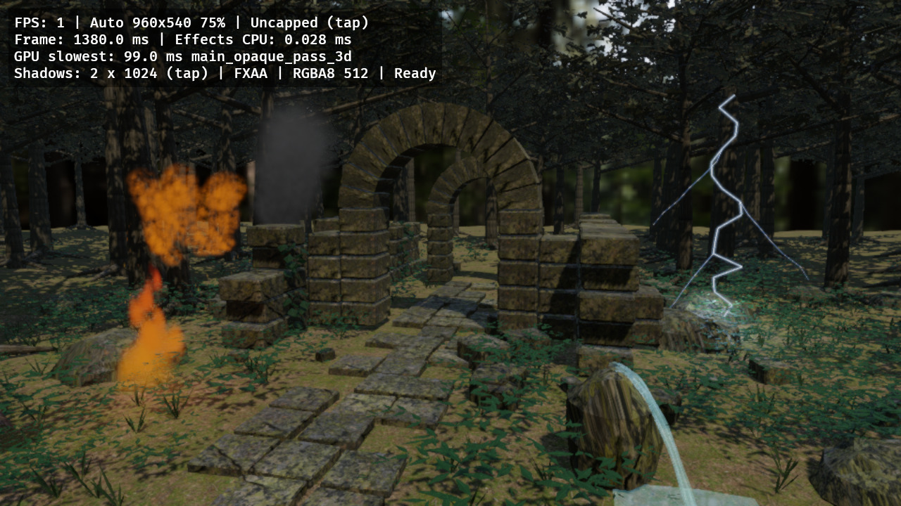

# Bevy Forest Test

以 **Bevy 0.20.0** 移植 [godot-test](https://github.com/edward9s/godot-test) 的森林與廢墟展示場景，提供 Android arm64 release APK 及桌面測試入口。

基準來源固定在 godot-test [`aee8e9cadd7089ff9450d220a2fc2958f55b5705`](https://github.com/edward9s/godot-test/tree/aee8e9cadd7089ff9450d220a2fc2958f55b5705)。目標是相近畫面下的 Android 效能。保留相同種子、地形、樹木、草葉、石牆及 385,622 個三角形／232 個空間批次；貼圖縮為 512²，陰影與抗鋸齒採較輕的設定。引擎的 PBR、陰影濾波與 ACES 實作不同，畫面須以同裝置截圖比較；實機回報的上一版只有約 4 FPS，尚未量得新版實機 FPS。



上圖為 512 貼圖、兩級 1024 陰影、FXAA 的固定時間點渲染：960×540 的 3D 畫面放大至 1280×720，文字介面以輸出原生尺寸繪製。截圖啟用 GPU 診斷，圖中的 FPS 來自 CI 軟體 Vulkan，不代表手機效能。完整 PNG 與 log 請查看最新 `forest-render` artifact。

## 畫面與操作

- 同樣的 52° 視角、起始位置、日照方向與固定曝光。
- 石牆／地面／樹皮的 albedo、normal、AO／roughness 貼圖；樹冠 alpha cutout、草葉紋理與透光。
- 完整植被風動，同一份頂點變形套用到顯示與陰影 pass。
- 兩級 40 m 太陽陰影，1024²／級與硬體 2×2 PCF；近級涵蓋 18 m，包含初始相機前的主要遺跡。深度貼圖總 texel 數從 16,777,216 降至 2,097,152，並將 4× MSAA 改為 FXAA。代價是較粗的陰影邊緣與不同的抗鋸齒效果。
- 同位置、數量與週期的火焰、爆炸、噴濺、閃電、濃煙、流水；三個動態點光源照亮鄰近物體。
- HDR 森林天空、預先卷積的漫反射／GGX 環境光、霧與 bloom。流水保留波紋、Fresnel 透明度及森林的一次性局部反射擷取；擷取完成後刪除六個額外攝影機。
- 單指／滑鼠左鍵拖曳旋轉、兩指捏合／滾輪縮放。
- 左上 FPS、平均 frame time、特效 CPU 耗時。GPU 診斷預設關閉，避免量測本身的負擔；勾選 Android workflow 的 `profile`，或桌面加上 `--profile`，可顯示最慢 GPU render pass 的耗時／名稱。不支援 timestamp query 時顯示 unavailable。這個數字是單一 pass，不能當成整幀 GPU 時間；啟用診斷的 FPS 應與關閉時分開比較。
- 點擊首行切換無垂直同步上限／VSync；點擊第四行切換陰影開關，供同裝置即時比較。正常展示預設有陰影。顯示 `Warming reflection` 時仍在初次反射擷取，請等 `Ready` 後比較穩態 FPS。

預設使用 **Auto 內部渲染解析度**，以人眼覺得相近的畫面優先爭取速度。3D 場景、HDR、bloom、FXAA 都在較小的 render target 執行，再以線性取樣放大；文字與介面由另一個攝影機以螢幕原生解析度繪製。左上顯示實際 3D 尺寸與相對螢幕的線性百分比；貼圖尺寸與這個比例分開。

初始長邊取螢幕的 75%，限制在 960～1280 像素；比 960 小的螢幕直接使用原尺寸。完成載入與反射後才調整：持續低於約 50 FPS 時逐步降至長邊 960，持續超過約 71 FPS 時逐步恢復細節，上限仍為長邊 1280。每次變動間隔至少兩秒，避免頻繁重建目標與清晰度跳動。這是畫質調節，無上限模式仍不鎖 FPS；陰影、風動、動態光與水面反射保持啟用。

例如 2560×1600 螢幕初始以 1280×800 渲染 3D，每幀場景像素數降至四分之一；介面仍是 2560×1600。代價是場景細節較柔和，品質下限仍需以實機觀感判斷。軟體 Vulkan 的 CI 渲染只用來檢查 shader／資產／渲染流程，不作手機效能數據。

## 執行時效能設計

- 幾何、切線、頂點去重、貼圖 mipmap 與 HDR IBL 在建置前產生，執行時只載入。
- 法線與切線量化至 0.0001 後去重；位置、UV、頂點色與風動權重保持一致。參考場景頂點從 1,140,524 減至 965,482，全部三角形保留。glTF 屬性分開儲存，批次使用可容納的 16／32-bit indices，減少 APK 與幾何負擔。
- 保留 10 m 空間批次及視錐剔除；植被 bounds 額外擴張 0.09 m，涵蓋風動位移。
- 建立所有批次的 bounds 後，靜態森林 mesh 只保留在 render world，釋放不再使用的 CPU 幾何副本。
- 植被與粒子運動由 GPU 執行，固定粒子拓樸；CPU 只計算粒子中心來排序透明度、更新三個點光源與不可見特效的開關；每組只上傳排序索引，不逐幀重建 mesh。CPU 光源與粒子排序和 GPU 使用同一個循環時鐘，避免長時間執行後不同步。
- 已完全透明的爆炸／閃電批次停繪，光源不增加陰影 pass。
- PBR 貼圖為 512²，包含完整離線 mipmap 與 4× anisotropic filtering。支援 ASTC 的 GPU 直接使用原生 ASTC 4×4 KTX2；其他 GPU 使用 RGBA8 DDS。兩種格式的 PBR GPU 紋理資料都降至前版的約四分之一，HDR 環境貼圖維持原尺寸；沒有執行時轉碼。
- 火焰、爆炸與煙霧先剔除必定透明的片段，再計算雜訊；雜訊 hash 改用乘加運算，保留三層流動紋理但改變細部花紋。
- release 使用 `opt-level=3`、Thin LTO、單一 codegen unit；未啟用動態連結與開發用 hot reload。

## GitHub 建置

### 持久依賴

[Persistent Bevy dependencies](.github/workflows/build_bevy.yml) 同時支援 `workflow_call`、手動執行，以及 main 上依賴相關檔案變更後自動執行。

依賴鍵包含 Cargo.toml（含 features／release profile）、Cargo.lock、rust-toolchain、實際 `rustc -vV`、目標平台及固定 Android NDK 設定。只改 `src/`、場景或 shader 不會改變這個鍵。

1. 有對應的 `bevy-deps-<hash>` Release：下載並驗證 SHA-256，還原 Cargo registry 與已編譯的 target。
2. 沒有對應 Release：以相同 package、features、Android target 與 release profile 編譯最小 scaffold，封存依賴，排除 scaffold 本身的產物。
3. 封存檔存為 Release 資產；不依賴 Actions cache 的閒置保留期。大於單一資產限制時自動分卷。
4. Android workflow 直接呼叫此 workflow，取得依賴鍵後從對應 Release 下載、驗證並還原，再編譯實際應用。依賴不再上傳或下載 Actions Artifacts；APK 仍保留 artifact 供下載。
5. 精確鍵不符就重新編譯；不降級到相近版本。封存檔毀損會立即失敗。

請保留 `bevy-deps-*` Releases。第一次建置仍需編譯 Bevy；Rust、依賴、features、NDK 或 profile 改動也會產生新的依賴鍵。快取命中後 Cargo 仍會依自己的 fingerprint 決定是否重編，不能保證任何環境變動下完全零重編。

新的依賴鍵須先在 main 建立 Release；其他分支缺少對應 Release 時會立即失敗，避免編譯後無法提供給 APK 工作。

依賴 Release 的 tag 使用發佈時的 default branch head，避免建置期間 main 更新後，GITHUB_TOKEN 無法替包含 workflow 差異的舊提交建立 Release。封存身分由依賴鍵核對，實際來源 SHA 記錄在 Release 說明。Thin LTO 的最終應用連結仍會執行。

### Android APK

在此 repository 設定以下四個 Actions secrets：

| Secret | 用途 |
| --- | --- |
| `KEYSTORE_BASE64` | 現有 keystore 的 Base64 |
| `KEY_ALIAS` | 簽署 alias |
| `KEY_PASSWORD` | 私鑰密碼 |
| `STORE_PASSWORD` | keystore 密碼 |

執行 [Android test build](.github/workflows/android.yml)。流程先檢查 secrets，再取得持久依賴、產生資產、建置 arm64 `.so`、封裝並驗證簽章。使用 Android NativeActivity，沒有 Java／Gradle 遊戲層，也不需要 cargo-apk。

產物：`BevyForest-test-arm64.apk`；同時取代 `test-build` prerelease 的 APK。需要 Android 8.0（API 26）以上與相容的 Vulkan 裝置。SDK 35、NDK `28.2.13676358`；原生 library 使用 16 KiB page alignment，APK 通過 `zipalign -P 16` 驗證。

Android application ID 為 `io.github.edward9s.bevytest`。新 repository 需要自行設定上述四個簽署 secrets；GitHub 不會隨原始碼搬移 secrets 或依賴 Release。

封裝時對原生程式庫副本執行 `llvm-strip --strip-unneeded`，移除不參與執行的靜態符號表，再以 ZIP 壓縮放入 APK。沿用 `extractNativeLibs=true`，由 Android 在安裝時解壓；執行時載入相同的原生程式碼。編譯產物保留供問題分析，場景與貼圖不變。

完成簽章驗證後先上傳 APK Artifact，再發布 Release，讓發布失敗時仍能下載 APK。`test-build` 為固定下載入口；tag 首次建立時使用 default branch head，後續只更新 APK 與 Release 說明。APK 的實際來源以 Release 說明中的 Commit 為準，避免建置期間 workflow 更新造成舊提交的標籤操作被 GITHUB_TOKEN 拒絕。

### 驗證

[Validate forest port](.github/workflows/check.yml) 執行 fmt、Clippy、解析度控制測試、資產拓樸與 DDS 完整性檢查，以及固定尺寸和變更尺寸的離屏 Vulkan 渲染。渲染錯誤會讓工作失敗，截圖與 log 放在 `forest-render` artifact。

解析度測試包含 Android 啟動前的零尺寸視窗，以及離屏目標改變尺寸後、Image asset event 尚未送達時的攝影機同步。Bevy 0.20 的攝影機更新早於 image event 發布，所以本專案在同一幀明確標記 Projection 更新，避免 GPU 已使用新貼圖而 viewport 仍保留舊尺寸。

場景 render target 明確設定 `copy_on_resize=false`：每幀都會清除並重畫，不需複製舊像素。Bevy 0.20 的 target 預設啟用複製，但預設 usage 沒有 `COPY_SRC`；未關閉複製時，啟動後採用螢幕實際尺寸或動態解析度調整會觸發 `copy_image_on_resize` 驗證錯誤並退出。GPU 回歸檢查依序驗證 1280×800、800×1280、800×480、960×540 四種場景尺寸，包含放大與縮小。

Android 的 native runner 結束後會以對應的成功／失敗狀態結束程序，確保再次開啟取得新的事件迴圈與 logger；單純切至背景不會執行這個結束程序。這也避免退出後重開累積 `RecreationAttempt` 與 logger 重複初始化錯誤。

Android 發生 Rust panic 時，會額外以 `BevyForest` tag 寫入 error 級別，包含原因與原始碼位置，原本的 panic handler 仍會執行。診斷閃退時請保留最早的 `BevyForest`／`RustPanic`、`Fatal signal` 或 `FATAL EXCEPTION` 訊息；Activity 參照已釋放後的 JVM callback 訊息本身不包含退出根因。

## 桌面執行

Ubuntu 所需：C++20 編譯器、curl、Python 3.12、Vulkan driver、`libx11-dev`、`libxkbcommon-dev`。Rust 由 rust-toolchain.toml 固定為 1.98.0。

```sh
pip install -r scripts/requirements.txt
python3 scripts/prepare_scene.py
python3 scripts/check_assets.py
cargo run --locked --release
```

不開視窗的渲染驗證（固定在 38.52 秒，讓全部特效同時可見；以固定 960×540 的 3D 場景合成至 1280×720，包含原生尺寸 UI，完成局部反射後擷取）：

```sh
cargo run --locked -- --capture=build/forest.png
```

包含 GPU 貼圖尺寸變更的回歸檢查：

```sh
cargo run --locked -- --check-resize --capture=build/resized.png
```

原始幾何位於 `vendor/Geometry.cpp`；資產產生器位於 `scripts/prepare_scene.py`；GPU shader 位於 `assets/shaders/`。下載來源與 SHA-256 固定於 `assets/sources.json`，生成資產不提交至 git。

## 素材與授權

詳見 [assets/CREDITS.md](assets/CREDITS.md)。幾何與匯出器來自上述固定的 godot-test 版本；本專案的 Bevy shader 介面參考 Bevy 0.20.0（MIT／Apache-2.0）。Poly Haven 素材為 CC0。
